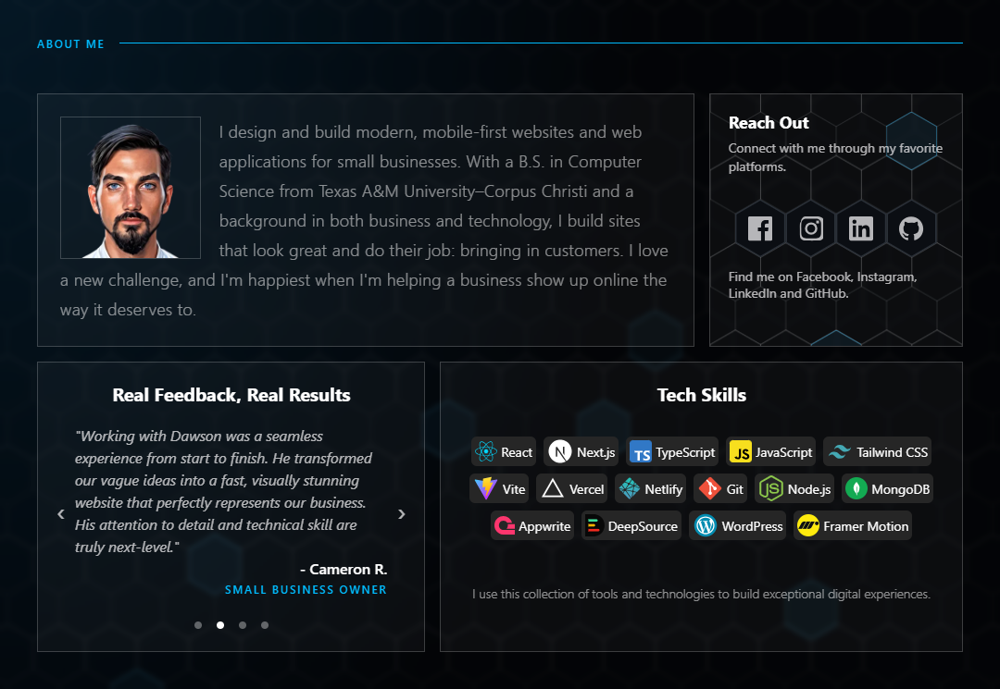
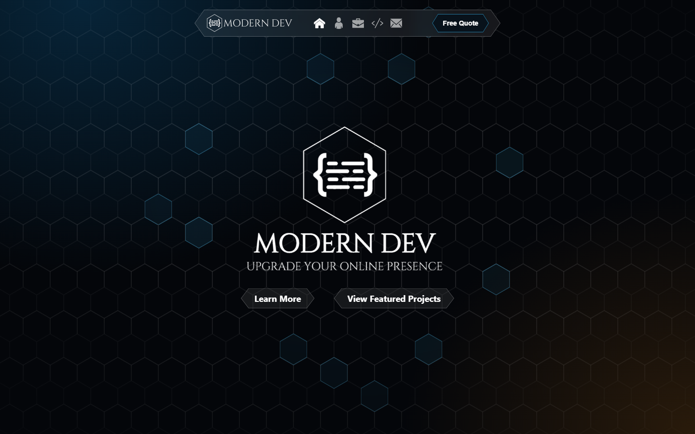
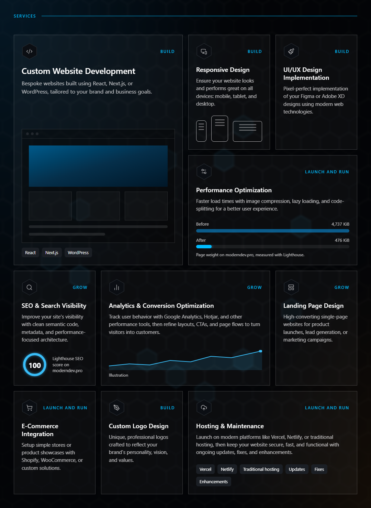
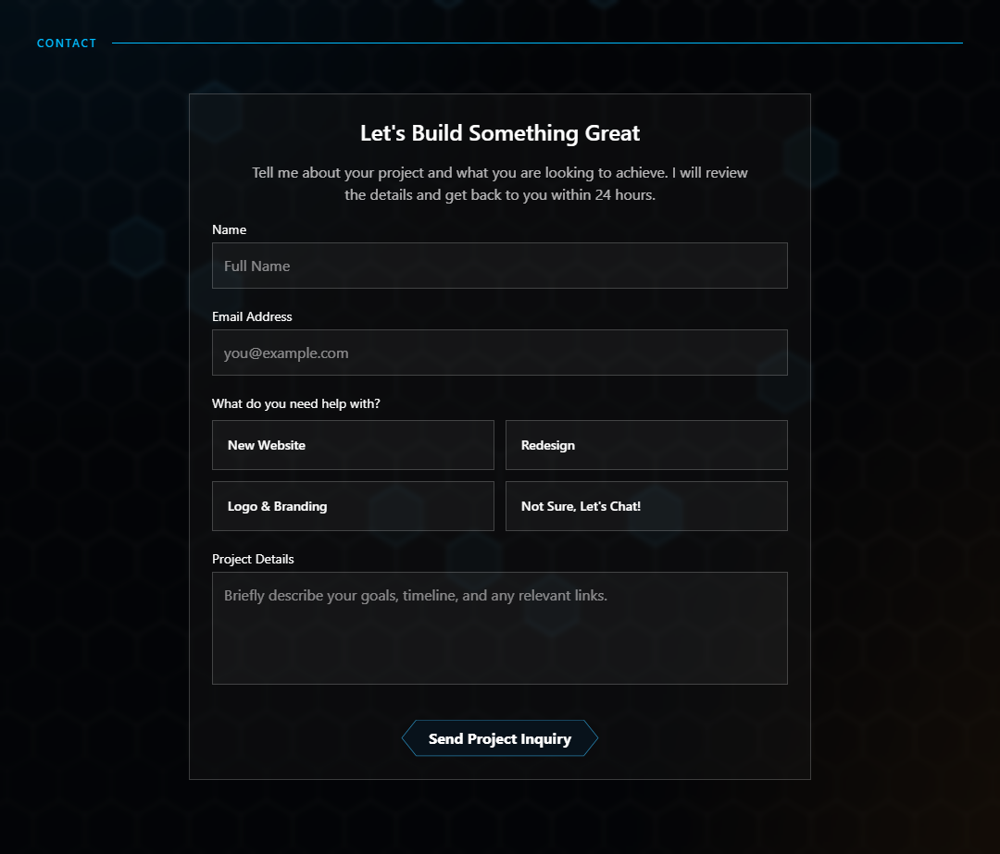

# Modern Dev

The portfolio and business site of Dawson Adams, a Texas-based freelance web developer. Built with Next.js, React and Tailwind CSS, with a focus on performance, a distinctive hexagon-based design, and a clear path from browsing to getting in touch.

**Live Site:** https://www.moderndev.pro

---

## Overview

Modern Dev is built to attract and convert small businesses looking to improve their online presence. Beyond looking polished, the site is meant to show the work itself: careful frontend engineering, thoughtful UX decisions, and attention to detail down to the pixel and the millisecond.

---

## Screenshots

| Hero | Services |
|------|----------|
|  |  |

| Contact |
|---------|
|  |

---

## Tech Stack

- **Framework:** Next.js 16 (App Router)
- **Frontend:** React 19 + TypeScript
- **Styling:** Tailwind CSS 4
- **Animation:** Framer Motion (`LazyMotion`)
- **Email:** Resend
- **Hosting:** Vercel, with Web Analytics and Speed Insights

---

## Key Features

- Fully responsive layout, checked from 320px phones up to wide desktops
- Hexagon design language taken from the logo: a faint lattice page background, hexagon-cut buttons and nav, and cut-corner project frames
- 3D logo carousel: logo design work rides a rotating ring, growing, brightening and glowing as each logo reaches the front
- Bento-style services grid with small illustrations, and a process timeline that lights up as you scroll
- Spotlight hover: a soft glow follows the cursor across every card
- Touch screens get a matching effect from scrolling: a card lights up while it sits at the middle of the screen
- Glass-style contact form with card-style service selection
- Accessible by default: keyboard focus styles, a skip link, reduced-motion support, and a pause control for the carousel
- SEO-friendly structure with semantic HTML

---

## Notable Engineering Decisions

### 1. A 3D Carousel Without a 3D Library

The logo carousel places each logo on a ring that turns around the vertical axis. A `requestAnimationFrame` loop works out every logo's angle and writes its position, size, opacity and glow straight to the element's style, so the animation never re-renders React. The loop only runs while the section is on screen, eases to a stop on hover, stands still for visitors who prefer reduced motion, and has a pause button that appears when reached with the keyboard. On phones the ring is wider than the screen, so logos fade out right at the edges.

---

### 2. Geometry-Based Social Card

The social card is a hexagon lattice with the icons sitting inside its cells. Everything is **derived from one unit**: the card is split into five cell widths using container-query units, and both the lattice and the icon positions are calculated from that unit, so icons stay aligned with their cells at every size. On phones, where the card spans the screen, a small measurement centres the icons exactly between the text and the bottom of the card, however the text wraps.

---

### 3. Hover That Works on Touch

Touch screens have no hover, so a `useScrollLit` hook watches each card with an `IntersectionObserver` and sets `data-lit` while it crosses the middle of the screen. Cards style both `hover:` and `data-[lit=true]:`, so the About cards, services, projects, social card and contact form light up the same way on any device.

---

### 4. Improved Form UX

The service selection was redesigned from standard radio inputs into **card-style selectable options**, giving lower cognitive load, a clearer visual hierarchy and a more engaging interaction.

---

## Performance

**Lighthouse (live site, mobile profile)**

| | Desktop | Mobile |
|---|---|---|
| Performance | 100 | 99 |
| Accessibility | 100 | 100 |
| Best Practices | 100 | 100 |
| SEO | 100 | 100 |

- **Images:** WebP everywhere, with `srcSet` and `sizes` so phones download 480 or 720px versions instead of full-size images. Logos are trimmed and converted from 1.6 MB of PNGs to 133 KB of WebP.
- **Loading priority:** the hero logo loads first with `fetchPriority="high"`; everything below the fold loads lazily.
- **No layout shift:** every image has explicit dimensions, so the page never jumps as images arrive.
- **Caching:** static assets are cached for a year as immutable. Edited images get a new file name (for example `-v2`) so visitors always see the latest version.
- **Less JavaScript work:** Framer Motion is loaded through `LazyMotion`, the hero entrance runs in CSS so it starts before JavaScript loads, and entrance animations are switched off on phones.
- **Smooth scrolling:** scroll-driven effects are throttled to one update per frame, and scroll position tracking uses `IntersectionObserver` instead of scroll math.
- **No forced reflows:** components that measure themselves read sizes from `ResizeObserver` reports after the browser has laid out the page, instead of forcing an early layout during startup.
- **Real-user monitoring:** Vercel Speed Insights tracks Core Web Vitals from real visitors, not just lab tests.

---

## Design & UX

- Dark, developer-focused aesthetic with sky-blue accents and a subtle amber glow
- One shape language throughout: hexagons from the logo appear in the background, buttons, icons and carousel
- Glass-style cards with consistent borders, labels and hover states
- Mobile-first, with micro-interactions that add polish without getting in the way

---

## Form Handling

The contact form is powered by **Resend**, giving reliable email delivery with a clean, minimal frontend experience and clear success and error messages.

---

## Future Improvements

- Add a blog to support content marketing and SEO
- Expand case studies to showcase more client work

---

## About

This project reflects my approach to frontend development: combining clean design, strong UX fundamentals and modern tooling to create fast, effective websites that solve real business problems.
