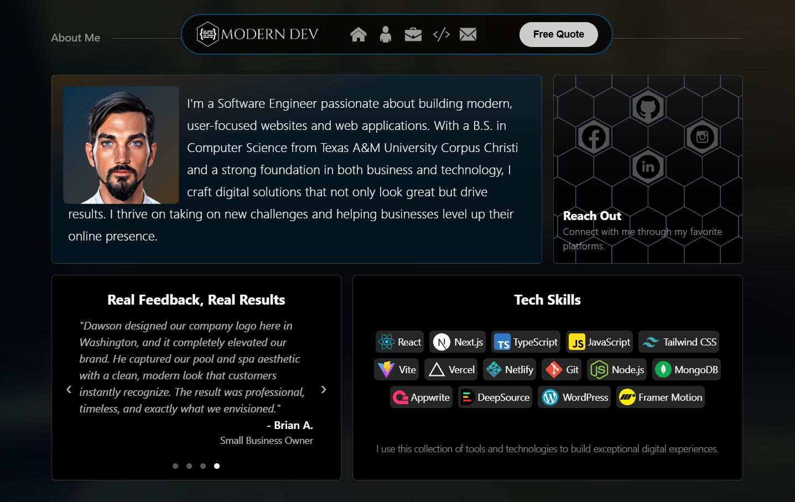
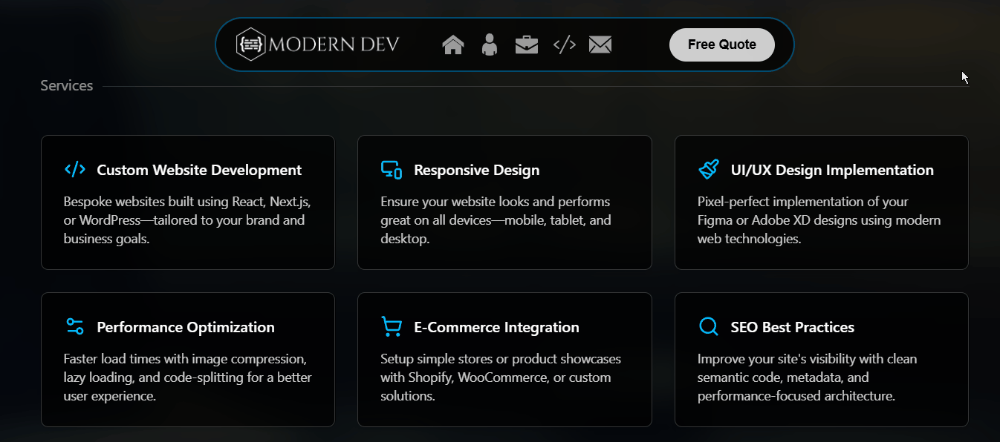
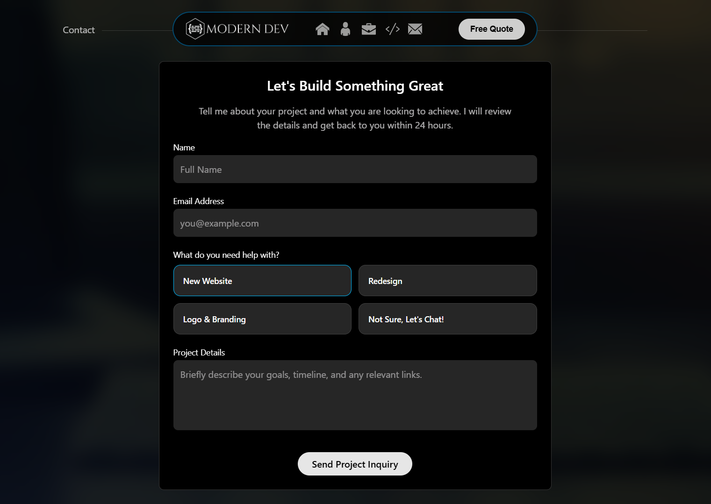

# Modern Dev

A custom-built developer portfolio and business website engineered with Next.js, React, and Tailwind CSS. Designed with a focus on performance, clean UI, and a conversion-driven user experience.

**Live Site:** https://www.moderndev.pro

---

## Overview

Modern Dev is a personal project built to attract and convert small to mid-sized businesses looking to improve their online presence. The goal was to create a site that not only looks polished, but also demonstrates strong frontend engineering, thoughtful UX decisions, and attention to detail.

---

## Preview

---

## Screenshots

| Hero | Services |
|------|----------|
|  |  |

| Contact |
|---------|
|  |

---

## Tech Stack

- **Framework:** Next.js  
- **Frontend:** React + TypeScript  
- **Styling:** Tailwind CSS  
- **Animation:** Framer Motion  
- **Deployment:** Vercel  

---

## Key Features

- Fully responsive layout, checked from 320px phones up to wide desktops
- Hexagon design language taken from the logo: a faint lattice page background, hexagon-cut buttons, nav and project frames
- Bento-style services grid and a scroll-lit process timeline
- Spotlight hover: a soft glow follows the cursor across every card
- Touch screens get the same effect from scrolling: a card lights up while it sits at the middle of the screen
- Glass-style contact form with card-style service selection and a restyled modal
- Entrance animations with Framer Motion (switched off on phones)
- SEO-friendly structure with semantic HTML

---

## Notable Engineering Decisions

### 1. Geometry-Based Social Card

The social card is a hexagon lattice banner with the icons sitting inside cells. Sizing icons separately from the lattice caused drift across breakpoints, so everything is **derived from one unit**: the card is split into five cell widths using container-query units, and both the lattice and the icon positions are calculated from that unit. The icons stay centered and fill their hexagons at every screen size, and the hover text lives in a fixed-height box so it never moves the icons.

---

### 2. Hover That Works on Touch

Touch screens have no hover, so a `useScrollLit` hook watches each card with an `IntersectionObserver` and sets `data-lit` while it crosses the middle of the screen. Cards style both `hover:` and `data-[lit=true]:`, so the About cards, services, projects, social card and contact form all light up the same way on any device.

---

### 3. Improved Form UX

The service selection was redesigned from standard radio inputs into **card-style selectable options**, resulting in:
- Lower cognitive load
- Clearer visual hierarchy
- A more engaging interaction pattern

---

### 4. Performance Work

- WebP images with `srcSet` and `sizes`, so phones download small versions
- Long-lived immutable caching headers for static assets
- Motion loaded through `LazyMotion` to keep the JavaScript small
- Explicit image dimensions to avoid layout shift

---

## Design & UX

- Modern developer aesthetic with a dark UI  
- Clean, minimal layout with a slightly premium feel  
- Mobile-first design approach  
- Subtle micro-interactions to enhance usability without distraction  

---

## Form Handling

The contact form is powered by **Resend**, enabling reliable email delivery with a clean and minimal frontend experience.

---

## Performance

**Lighthouse Scores:**

- Performance: 95  
- Accessibility: 100  
- Best Practices: 100  
- SEO: 100  

_Measured on the live site, mobile profile._

---

## Future Improvements

- Add a blog to support content marketing and SEO  
- Expand case studies to showcase real client work  

---

## About

This project reflects my approach to frontend development: combining clean design, strong UX fundamentals, and modern tooling to create fast, effective websites that solve real business problems.
